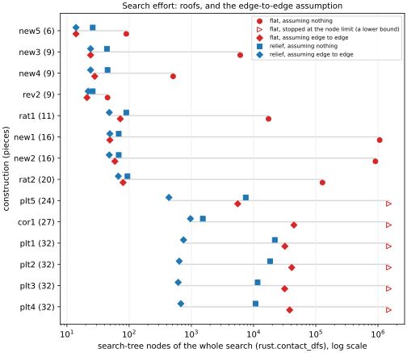

# tiling-solvers

A solver laboratory for geometric tiling puzzles, starting with the tropical puzzles published by [Tropical Puzzle Lab](https://github.com/maxpluslab/tropical-puzzle-lab). It is a research platform, not a single solver. Several search methods run on the same puzzles, behind one contract, with an independent validator and reproducible benchmarks. The question it asks is what makes a puzzle hard for a search, and what helps.



*Search effort for each construction (pieces in brackets), as nodes in the search tree of `rust.contact_dfs` with default options and tolerances, node limit 1 500 000. Each point is a whole search, with every assembly found, unless it is an open arrow: those flat searches were stopped at the limit, so their true cost is larger. Nodes are not running times and not a measure of how hard a puzzle is for a person. Data: [corpus.md](benchmarks/results/corpus.md) and [edge_to_edge.md](benchmarks/results/edge_to_edge.md); drawn by `uv run maxplus-bench figure`.*

## At a glance

**Three solvers, one contract.** Each takes a sanitized puzzle and returns assemblies, with a statement of what it searched and whether it searched all of it ([solver contract](docs/solver-contract.md)).

- `rust.contact_dfs` is the main solver. It is a depth-first search that places one piece at a time against the pieces already down, in contact along edges and corners. Every pruning rule, ordering and symmetry reduction can be switched off, and it can be told to assume that pieces meet edge to edge.
- `cp_sat.placements` hands the placements that search generates to OR-Tools CP-SAT as a choice problem. It is a second formulation over the same candidates, which checks the search's bookkeeping. It is not an independent enumeration of every possible placement.
- `python.contact_dfs` is the Python prototype the Rust search was built from. It has no pruning and no tray symmetry, and is kept as a reference.

**Three information regimes,** never compared with each other: **footprint**, the polygons only (the app's *Flat* mode); **relief**, the polygons and the planes of their roofs (*Relief* mode); and *tropical-aware*, which would add the construction data and which no solver uses yet. On top of a regime, a solver may make an **assumption**. Today the only one is `edge-to-edge`: it narrows which assemblies count, so results under it are reported separately.

**Reproduce the tables:**

```sh
uv run maxplus-bench run benchmarks/manifests/corpus.toml --no-times        # benchmarks/results/corpus.md
uv run maxplus-bench run benchmarks/manifests/edge_to_edge.toml --no-times  # benchmarks/results/edge_to_edge.md
```

Each takes several minutes, most of it on the footprints that run to the node limit. The committed tables hold statuses and counts only, which a deterministic solver reproduces exactly, and the test suite compares every row it can afford to rerun. [docs/experiments.md](docs/experiments.md) has the other experiments (tolerance, heuristics, difficulty proxies) and what they found.

## What we've learned so far

Four findings, in plain terms. Unless a finding says otherwise, every number is a count of search-tree nodes from `rust.contact_dfs` with default options and tolerances, in a search that ran to its end and assumed nothing. Puzzles are named by fixture id, with the app's name on first use (see [the table below](#names-in-the-puzzle-app)).

- **The third dimension changes the search problem.** `new1` (Hill 16a) has 16 pieces. In the footprint regime the search needs 1 064 878 nodes to find its assembly and show there is no other. With its roofs, the same pieces need 68 nodes, more than four orders of magnitude fewer. The roofs work by saying which edges can meet. A piece edge of flat `new1` could lie against about 77 of the 82 edges on average. With roofs, the average is 1.2 to 6.7 possible partners on every relief puzzle except Pleat (below). ([experiments](docs/experiments.md#flat-against-relief-tolerance-heuristic-puzzle))
- **Knowing the structure can matter more than a better search.** Tropical cuts never leave a T-junction between pieces. Assuming the pieces meet edge to edge takes flat `new1` from 1 064 878 nodes to 49, fewer than its roofs alone need. Finding that structure helped more here than any improvement to the search. It is an assumption, though, not a shortcut, because it narrows which assemblies count. For example, `rat1-flat` (Terrain 11a, flat) has 101 assemblies, and only the intended one has no T. ([algorithms](docs/algorithms.md#assuming-the-pieces-meet-edge-to-edge))
- **Difficulty has more than one dimension.** The number of pieces is not a reliable guide. Two nine-piece footprints, `rev2-flat` (Bowl 9a) and `new3-flat` (Hill 9a), cost 45 and 6 104 nodes. Ambiguity varies as well: the 11-piece `rat1` has 101 assemblies without its roofs and one with them. ([difficulty proxies](docs/experiments.md#difficulty-proxies))
- **Roofs can be made to help less.** The Pleat puzzles were built for this in Tropical Puzzle Lab. They stand every corner of a grid of triangles at one of just two heights, so even with roofs an edge has 16 to 24 possible partners on average. With its roofs, the hardest, `plt1` (Pleat 32a, 32 pieces), takes 21 973 nodes and has one assembly. That compares with 1 529 for `cor1` (Corrugated 27a) and at most 94 for the other relief puzzles. Without roofs, every Pleat search was stopped at the node limit, having found at least 26 998 to 95 344 assemblies and still finding more. With roofs and assuming edge to edge, `plt1` takes 749 nodes. CP-SAT, given the same placements, settles every Pleat relief puzzle without a single conflict (its own count, from a run by hand). So the Pleat puzzles are hard for this search, not for every method. ([experiments](docs/experiments.md#the-corpus-table))

One question is still open. `cor1`, with 27 pieces, was built to be hard, and its footprint search has not been seen to finish: it was stopped without an assembly at 1 500 000 nodes in the table and at 3 000 000 by hand. Assuming edge to edge, it does finish, with 48 assemblies in 44 539 nodes.

## What the numbers are, and are not

- **Relative to the candidates.** A solver searches the placements it generates: pieces in contact along edges and corners, within a contact tolerance. "One assembly" means a search that ran to its end over that candidate set found exactly one. It is not a proof that no other assembly exists. Every result names its candidate set and says whether that set is proven complete (so far, it never is).
- **Floating point.** The geometry is `f64` with explicit, stated tolerances, not exact arithmetic. Nothing here is a mathematical proof.
- **Exact counts and lower bounds.** In the tables, "Whole search: yes" means the count is every assembly over the candidate set. "no" means the search hit its node limit, so the assemblies and nodes it reports are lower bounds.
- **Checked independently.** Every assembly in the committed tables passes an independent validator (`python/maxplus_solvers/validation.py`, on Shapely). It shares no code with the search and follows the browser player's completion rules, departing from them only on the stricter side.
- **Search effort, not human difficulty.** Nodes count what this search tried, and depend on its rules. They are not running times, and nothing here has measured a person.

[docs/solver-contract.md](docs/solver-contract.md) says exactly what a result claims.

## Names in the puzzle app

The app shows puzzles by name, with a **Relief | Flat** switch. Here they are fixture ids: the id is the relief puzzle, and `-flat` the same footprints without roofs (the footprint regime). An assembly here is what the app calls a solution: a placement of every piece that passes the completion rules.

| Id | App name | Pieces | | Id | App name | Pieces |
| --- | --- | --- | --- | --- | --- | --- |
| `new5` | Hill 6a | 6 | | `rat2` | Terrain 20a | 20 |
| `new3` | Hill 9a | 9 | | `cor1` | Corrugated 27a | 27 |
| `new4` | Hill 9b | 9 | | `plt1` | Pleat 32a | 32 |
| `rev2` | Bowl 9a | 9 | | `plt2` | Pleat 32b | 32 |
| `rat1` | Terrain 11a | 11 | | `plt3` | Pleat 32c | 32 |
| `new1` | Hill 16a | 16 | | `plt4` | Pleat 32d | 32 |
| `new2` | Hill 16b | 16 | | `plt5` | Pleat 24e | 24 |

The app's 1–5 difficulty rating is derived from this repository's node counts. It describes this search, not a person's experience.

## Quick start

You need [uv](https://docs.astral.sh/uv/) and a stable [Rust toolchain](https://rustup.rs/).

```sh
uv sync            # creates .venv, builds the Rust extension, installs the dev tools
uv run pytest      # Python tests
cargo test --workspace --exclude tiling-py   # Rust tests
```

`uv sync` installs the development group, which includes Shapely (the validator), OR-Tools (CP-SAT) and matplotlib, so everything below works from a fresh checkout. A user installing the package picks these as the extras `validate`, `cp-sat` and `analysis`; the Rust solvers need none of them. `uv sync` and `uv run` rebuild the extension when Rust sources change.

Solve a puzzle from the command line:

```sh
uv run maxplus-solve new5-flat --max-solutions all --validate
```

```text
rust.contact_dfs on 9352aafe3966 (footprint): solved
  the search ran to its end; candidates corner-contact/1, not proven complete
  solution 1: 6 pieces, valid
  nodes=90, backtracks=70, placements=89, candidates_generated=968
  ...
```

More examples:

```sh
uv run maxplus-solve new2 --mode relief --max-solutions all --validate
uv run maxplus-solve new1-flat --assume edge-to-edge --max-solutions all --validate   # 49 nodes
uv run maxplus-solve rat1-flat --max-solutions all --option closure_pruning=false     # a rule switched off
uv run maxplus-solve rat1-flat --solver cp_sat.placements --max-solutions all
```

Or from Python:

```python
from maxplus_solvers import SolverConfig, load_puzzle, solve

puzzle = load_puzzle("benchmarks/fixtures/new2.json")
# The same pieces without roofs:
flat = load_puzzle("benchmarks/fixtures/new2.json", regime="footprint")

config = SolverConfig("rust.contact_dfs", mode="relief", max_solutions=None)
result = solve(puzzle, config, validate=True)
print(result.status, len(result.solutions), result.exhaustive, result.metrics["nodes"])
```

The validator can also be called on its own, on any poses:

```python
from maxplus_solvers.validation import validate_solution

report = validate_solution(puzzle, poses)  # poses: {piece id: Pose}
print(report.solved, report.failed, report.residuals())
```

## Status

- **Contracts and fixtures.** The corpus is 28 puzzles from Tropical Puzzle Lab: fourteen constructions, each with its roofs and without. There are also 4 synthetic puzzles with known solution counts. Each has an answer key that only tests read. The sanitizing importer strips everything that hints at the answer.
- **Validator.** An independent check of an assembly against the browser player's completion rules.
- **Geometry.** A Rust kernel (separating-axis depth, convex clipping, containment, edge signatures, roof continuity), tested against the validator on random poses of every fixture's pieces.
- **Solvers.** `rust.contact_dfs` runs the search to its end on 22 of the 28 corpus puzzles, and every assembly it returns passes the validator. The other six are footprints it stops at 1 500 000 nodes: `cor1-flat`, and the five Pleat footprints, of which each still has more assemblies to find at the limit. Assuming edge to edge, it finishes all 28. `cp_sat.placements` returns the same assemblies on every puzzle it is given.
- **Experiments.** `maxplus-bench` runs TOML manifests over the corpus and writes the result tables. The findings so far are in [docs/experiments.md](docs/experiments.md), and the measurement behind each search rule is in [docs/algorithms.md](docs/algorithms.md).

The work is laid out phase by phase in [docs/roadmap.md](docs/roadmap.md), and the design in [docs/architecture.md](docs/architecture.md).

## Layout

```
crates/
  tiling-core/       shared domain types
  tiling-geometry/   convex geometry, contact matching, candidates
  tiling-search/     custom Rust solvers, one module each
  tiling-py/         PyO3 bindings only
python/maxplus_solvers/   the Python package; `_native` is the Rust extension
schemas/             versioned exchange formats (`instance-v1.json`)
benchmarks/fixtures/ sanitized puzzle instances, generated
benchmarks/manifests/ experiments: which fixtures, solvers and settings to run
benchmarks/results/ result tables, generated by `maxplus-bench`
notebooks/           a first look at results, with figures
scripts/             `import_fixtures.py` regenerates fixtures and answer keys
tests/               pytest suites: unit, property, corpus, architecture; answer keys in `tests/keys/`
docs/                architecture, roadmap, the solver contract, the algorithms and the experiments
docs/figures/        the figure above, drawn from the committed tables
```

## Relation to Tropical Puzzle Lab

Tropical Puzzle Lab remains the authority for constructing puzzles and for the rules of completion. This repository reads its published `puzzle.json` format and turns each puzzle into a sanitized solver instance: no reference poses, no construction metadata, and pieces rotated and shuffled so that nothing about the stored form hints at the answer. The fixtures record the source commit they were imported from.

## License

[MIT](LICENSE)
